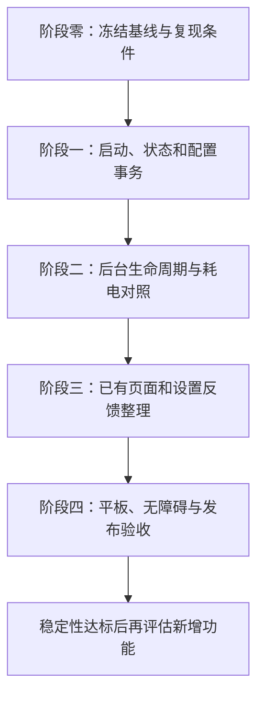

# TunBox 稳定性、保活与 UI 详细整改方案

> 文档日期：2026-10-23（北京时间）  
> 方案版本：1.0  
> 项目：TunBox HarmonyOS  
> 代码基线：`0.6.0 / versionCode 528` 当前工作区  
> 文档性质：后续整改与验收计划。本文中的“拟整改”“目标”“验收项”均不代表已经实现或已经通过真机验收。  
> 2026-10-25 更新：音频保活（AudioKeepAlive / audioPlayback 长时任务 / 设置页开关）已整体移除（0.6.2 卡顿排查结论），本文中涉及音频保活的条目（P0-06 等）随之作废。  
> 本次交付范围：编写方案，不在本次文档任务中修改产品代码、重打包或发布。

## 目录

1. 目标、范围与产品约束
2. 当前基线与已知事实
3. 整改优先级与任务总表
4. P0：启动可靠性与配置安全
5. P0：会话、保活与耗电
6. P1：设置生效、备份与可回退配置
7. P1：UI 与日常操作体验
8. P1：节点查找、规则排查和配置管理的后续规划
9. P2：鸿蒙适配、平板与无障碍
10. 指标、真机矩阵与测试方法
11. 实施阶段、交付物与依赖关系
12. 发布门禁、回退与问题闭环
13. 执行任务清单
14. 参考代码、验证脚本与资料

---

## 1. 目标、范围与产品约束

### 1.1 核心目标

优先保证以下体验：

- 用户导入有效配置后，首次连接具有可预测的结果。
- 新装、正常升级、清缓存、资源更新失败等情况下，应用按同一套规则处理启动依赖。
- 前后台切换、锁屏和网络切换过程中，真实会话得到正确保留、恢复和清理。
- 用户主动断开后，任何迟到的回调、定时器、更新结果都不能重新建立连接。
- UI 正确反映实际会话；测速结果、通知和服务卡片保持一致。
- 每个关键改动都有复现条件、回归用例和真机证据。

### 1.2 本轮实施范围

本轮优先实施 P0 稳定性与保活整改，以及直接改善理解和操作反馈的 UI 整理。

以下内容在本方案中写明设计与验收要求，待 P0 达标后再安排开发：

- 节点搜索、收藏、最近使用、地区筛选。
- 新的规则排查工具和从连接记录创建规则。
- 模块化配置覆写和新的自动化场景。
- 扩展型插件、MITM、JavaScript 生态。

已有功能仍需修复缺陷和完成回归；暂缓新增功能不意味着忽略已有功能的错误。

### 1.3 已确定的产品约束

| 项目 | 本方案遵循的约束 |
|---|---|
| 规则路由引擎 | 新装、字段缺失或非法值时默认关闭；显式保存的有效选择保留。 |
| 去广告 | 独立开关，默认关闭；与规则引擎分开校验依赖。 |
| 音频保活 | 默认关闭，由用户选择；评估收益时同时记录耗电、音频中断及媒体控制影响。 |
| 原文 provider 开关 | 沿用当前默认关闭；未经完整验证不改为默认开启。 |
| IPv6、嗅探等已有默认值 | 先测量和做组合回归；任何改变需有兼容性证据与明确版本说明。 |
| 测速提示 | 不显示“失败分类分散”、超时节点数量、失败数量、过载数量等组级汇总横幅或弹窗。 |
| 升级数据 | 沿用用户选择的手动备份/恢复方案，不在本轮补做 0.5 旧命名空间自动迁移。 |
| 页面导航 | 保留主页、订阅、设置三个主页签；子页沿用当前导航关系。 |
| 既有布局决定 | 公网 IP、订阅展开操作、单/双列节点等位置和行为先保留；改变前明确说明影响。 |
| 单节点分组 | 保留已确定的退场方案，沿用订阅转换与文件导入流程。 |
| 产品风格 | 保留现有品牌色、深浅主题和悬浮导航；本轮以层级、可读性和一致性整理为主。 |

### 1.4 质量原则

1. 一个连接请求只对应一个有效会话代次。
2. 连接前校验的是最终生效配置，原始订阅校验通过只是其中一步。
3. 用户当前可用配置在新配置确认可用前保持可恢复。
4. 资源就绪必须有实际文件与有效性证据；文件存在、内存标志和大小相近都不是充分证据。
5. 系统暂停、系统取消、用户停止、音频中断、网络断开分别处理。
6. Windows 同源内核、本地替身测试、DevEco 编译、鸿蒙真机验收分别记账。
7. 网络、权限和设备状态导致的失败要能解释；测试指标不能通过隐藏失败来改善。

---

## 2. 当前基线与已知事实

### 2.1 已具备的主要能力

- 三页签主界面、深浅主题、连接控制、实时流量与公网 IP。
- URL、二维码、文件导入订阅，以及订阅转换。
- 当前 Profile 管理、完整 YAML 处理、节点测速和结果持久化。
- 应用分流、网站分流、路由规则、独立去广告和 YAML 覆盖入口。
- 活动连接列表、命中规则/出口链摘要和连接关闭操作。
- 配置备份、恢复、日志与诊断面板。
- 后台任务协商、30 秒自检、可选音频保活、前台会话接管和服务卡片。

因此本方案重点是让已有能力在异常条件下保持一致，并降低用户理解成本。

### 2.2 最近已修复的基线问题

| 构建/阶段 | 已处理内容 | 当前证据 |
|---|---|---|
| 0.6.0 审查阶段 | 订阅校验、别名/Base64、配置新鲜度、组选点、测速取消/收尾、异步停止内核 | 专项脚本与部分历史设备验证，详见原审查记录。 |
| 525 | 遗留连接意图影响未连接测速；未开始却显示测速完成 | 运行时回归；525 的安装记录为历史记录。 |
| 527 | 规则默认关闭；自定义 GEOIP 缺库保护；移除测速汇总提示 | 默认值、配置生成与真实内核回归。 |
| 527 | 暂停恢复漏接进度心跳；旧任务事件误撤销新守护；系统普通取消后重复等待 | 保活 26 项、前台会话 24 项专项回归。 |
| 528 | Geo 数据复制失败不重试、只看大小、缓存删除后不重建、非原子写入和资源视图越界写入 | 新专项 43 项通过，包含 64 份真实内核配置校验与 4 次本地内核实际启动。 |

### 2.3 当前仍需补足的证据

- 528 尚未在当前未连接的设备上安装验收。
- 缺少覆盖多台设备的锁屏长时存活、耗电与内存基线。
- 缺少严格控制配置、网络和签名条件的“稳定 0.5 版本—528—候选整改版”对照结果。
- 新增结构检查不能证明数据库每条记录、任意第三方规则和所有远程资源都有效。
- 历史全量回归通过记录不代表 528 将全部脚本重新跑过。
- 尚未完成最新版本逐屏截图、系统大字体和宽屏 UI 的统一验收。

### 2.4 为什么之前只影响部分用户

已复现的故障与以下条件有关：

1. 配置中是否实际引用 GEOIP、GEOSITE、远程规则集或模型。
2. 本地数据是否存在、可读、完整，是否真正铺盘成功。
3. 缺失数据是否让内核在启动关键路径中同步联网。
4. 当前网络能否完成下载，以及耗时是否超过客户端启动预算。

用户的订阅、缓存和网络各不相同，因此触发结果不同。此前只按文件大小判断、复制前设置成功标志等客户端缺陷，进一步放大了差异。

这些是已复现的故障链路；没有某个用户的日志和复现条件时，该用户的根因仍应标记为待确认。

---

### 2.5 开始实施后的执行记录

2026-10-23 已开始第一批 P0 整改，当前候选版本码为 531（529/530 为中间包；530 暴露的图标串位已由 531 的清理构建与资源编号门禁修复）。修改、回归及真机证据见[第一批执行记录](C:/Worker/TunBox/TunBox_HarmonyOS/docs/REMEDIATION_BATCH1_2026-10-23_0.6.0.md)。本方案中的 528 为开始实施前的基线；未完成的长时、多设备和后续 UI 验收仍按原门槛执行。

## 3. 整改优先级与任务总表

| 编号 | 优先级 | 任务 | 实施位置/对象 | 阶段 |
|---|---|---|---|---|
| P0-01 | P0 | 最终配置与启动依赖检查 | RuntimeConfigBuilder、配置合并、资源安装 | 第一阶段 |
| P0-02 | P0 | 启动、取消、停止事务及资源收尾 | ConnectionOrchestrator、CoreBridge、VPN 扩展 | 第一阶段 |
| P0-03 | P0 | 会话权威状态与错误判断 | UI、扩展状态、控制器、心跳 | 第一阶段 |
| P0-04 | P0 | 配置应用失败保留可用版本 | 规则保存、订阅刷新、热加载 | 第一阶段 |
| P0-05 | P0 | 后台任务生命周期与事件归属 | UiGuardian、BackgroundTaskWatch | 第二阶段 |
| P0-06 | P0 | 音频保活中断与媒体场景验收 | AudioKeepAlive、设置页、后台任务 | 第二阶段 |
| P0-07 | P0 | 网络变化和有界恢复 | NetworkStateWatcher、编排器、VPN 扩展 | 第二阶段 |
| P0-08 | P0 | 耗电、内存、FD 与定时器治理 | UI 轮询、内核、日志、后台任务 | 第二阶段 |
| P0-09 | P0 | 版本与设备验证基线 | 测试夹具、脚本、签名安装包 | 全程 |
| P1-01 | P1 | 设置生效说明和失败回退 | SettingsPage、RulesPage、设置服务 | 第三阶段 |
| P1-02 | P1 | 手动备份与恢复流程完善 | BackupRestoreService、备份入口 | 第三阶段 |
| P1-03 | P1 | 首页信息层级、状态与反馈 | HomePage、诊断面板 | 第三阶段 |
| P1-04 | P1 | 订阅与节点页操作一致性 | SubscriptionPage、节点行、导入弹窗 | 第三阶段 |
| P1-05 | P1 | 全页面视觉和交互一致性 | 设计令牌、公共组件、各子页 | 第三阶段 |
| P1-06 | P1 | 节点查找、收藏与最近使用 | 产品设计与后续任务拆分 | 后续功能储备 |
| P1-07 | P1 | 规则排查和配置管理增强 | 连接列表、规则页、Profile 管理 | 后续功能储备 |
| P2-01 | P2 | 平板、窗口变化和大字体 | 页面布局与导航容器 | 第四阶段 |
| P2-02 | P2 | 无障碍、服务卡片与通知一致性 | 控件语义、卡片、通知 | 第四阶段 |
| P2-03 | P2 | 网络策略自动化与扩展能力 | 需求设计与平台能力核实 | 后续功能储备 |

依赖顺序：先建立测量与复现基线，再完成启动/会话整改，再验证保活与能耗，之后推进 UI 和平台适配。

---

## 4. P0：启动可靠性与配置安全

### 4.1 P0-01：最终配置与依赖检查

#### 现状与风险

- 订阅原文、App 设置和覆盖内容会共同生成最终配置。
- `prepareProfile` 的离线文档校验不是完整的设备运行环境检查。
- 自定义规则、订阅规则、DNS 段、子规则和 provider 都可能引入依赖。
- 只检查 App 生成部分，可能遗漏完整 Profile 合并后重新出现的依赖。

#### 整改步骤

1. 对当前生成链路建立依赖清单，记录每种配置项需要的资源及检查位置。
2. 检查最终 YAML 中实际保留的规则、DNS、策略组、子规则和 provider 引用。
3. 校验策略目标、provider 名称、嵌套策略组关系以及当前选择的节点确实存在。
4. 对 GeoIP、GeoSite、规则集、模型、文件型 provider 做本地状态检查。
5. 把远程资源首次获取、更新失败及过期处理从 TUN 建立流程中拆出，明确其截止时间和使用旧资源的条件。
6. 合并结束后进行最终配置校验，记录本次配置版本和实际采用的功能状态。
7. 启动前检查与热加载前检查复用同一套判断，不为测速核单独复制规则。

#### 依赖处理规则

| 对象 | 处理要求 | 失败策略 |
|---|---|---|
| 当前代理节点及策略组 | 必须存在且引用完整 | 拒绝应用候选配置，保留当前可用会话。 |
| 仅由远程 proxy-provider 提供的节点 | 获取后确认确有可用成员 | 不能以空节点表宣称已连接，也不能擅自退回全量直连。 |
| 应用分流授权及模式 | 确认模式、包名、代次与配置一致 | 按既有保护策略阻止不明确的接管。 |
| App 提供的可选去广告 | 检查随包资源和本地可用文件 | 允许候选运行配置暂不启用该可选能力；状态在详情中可查。 |
| App 提供的可选地域直连优化 | 使用现有就绪检查，并验证最终规则顺序 | 缺资源时只采用经确认安全的既有降级；保留用户配置。 |
| 用户明确设置的拦截、强制代理或必要规则集 | 视为用户要求的路由语义 | 不静默删除后宣布应用成功；失败保留旧配置并说明未应用。 |
| smart 模型 | 本地就绪后才声明对应组 | 采用当前明确的手动/普通策略；不在启动期无预算下载。 |
| DNS 及其 Geo 引用 | 与最终 DNS 段一起检查 | 不随意替换用户 DNS 或导致流量走向变化。 |

#### 资源文件规范

- 临时文件与目标文件放在同一受控目录，使用独立名称。
- 检查资源视图范围、实际写入字节数、文件格式和必要的语义。
- 写入完成并关闭后原子替换；需要掉电耐久保证的位置核实平台 flush/fsync 能力。
- 替换失败保留旧文件；失败结果不能进入“安装成功”的进程缓存。
- UI 与扩展同时操作时，检查并发替换、更新版本保留及临时文件清理。
- 文件删除、改写、目录变化和资源版本变化后，旧检查结果失效。
- 远程更新不得把 HTML 错误页、截断内容或仅有正确文件头的错误内容作为新资源提交。

#### 验收标准

- 全新安装且无法访问资源下载地址时，使用随包资源的标准配置仍能启动。
- 规则/去广告/IPv6/嗅探组合均有最终配置证据，不仅检查开关字段。
- 缺失、同大小损坏、更大损坏、半写入、读写异常、资源视图偏移均有回归。
- 只有 provider 的订阅在未获取节点时明确失败，不误报成功。
- 候选配置失败后，原可用配置、节点选择和运行会话能够恢复或继续使用。

### 4.2 P0-02：连接操作事务与资源收尾

#### 整改步骤

1. 为连接、停止、切换配置、重连和热加载明确入口与互斥关系。
2. 所有异步步骤携带会话代次；完成时再次核对当前意图与代次。
3. 为各阶段设置独立预算：资源准备、端口选择、内核启动、控制器认证、TUN 建立及提交状态。
4. 保留总预算；超时后进入可追踪的清理状态，不仅修改 UI 为“失败”。
5. 审核 Native/Go 阻塞期间的停止语义，确认线程、锁和异步工作真正收尾。
6. 启动前避免提前清除仍可用会话的资源，明确需要停止旧会话的边界。
7. 取消或失败后检查 TUN、VPN 连接、监听端口、临时配置、回调、订阅和任务通知的归属。

#### 必测操作序列

- 快速连续点击连接。
- 启动中点击取消，再立即连接。
- 连接中切换订阅/节点。
- 热加载未完成时点击断开。
- 订阅刷新和测速同时发生。
- UI 退后台或销毁时，内核异步启动刚完成。
- 旧停止回调晚于新连接完成。
- 配置写入失败、端口冲突、VPN 授权拒绝、TUN 创建失败。

#### 验收标准

- 同时只有一个有效的真实 VPN 会话。
- 手动断开后不会被旧回调、旧任务、旧更新或旧定时器重新拉起。
- 任何操作结果都能归属到具体请求和配置版本。
- 重复连接/断开压力测试后，FD、线程、端口和后台任务数量回到可解释的稳定范围。
- 用户取消后立即有反馈，资源清理完成时间单独记录。

### 4.3 P0-03：会话权威状态和 UI 状态

#### 状态判断分层

| 层次 | 需要回答的问题 |
|---|---|
| 用户意图 | 用户是否仍要求连接？是否已主动停止？ |
| 会话代次 | 当前结果属于哪一次连接？ |
| 扩展状态 | 扩展是否报告当前会话及 TUN 运行状态？ |
| 内核状态 | 内核与认证控制器是否可用？ |
| 租约/心跳 | 最近一次可信更新时间是什么？是否只是被调度暂停？ |
| 业务连通性 | 隧道建立后，实际请求是否可达？ |
| UI 展示 | 当前页面能否准确反映上述结果？ |

#### 整改要求

- UI 进程恢复时优先接管确认存活的会话，保留连接开始时间。
- 单次接口失败、一次陈旧心跳或公网 IP 查询失败不直接等同于隧道死亡。
- 控制器可达但认证失败时，先识别密钥/配置不一致，避免创建第二个内核。
- 多次独立证据确认失效后，才按用户意图进入恢复流程。
- “已连接”与“业务连通性异常”分别表达，避免为一次出口查询失败拆建整个 VPN。
- 页面、通知、卡片、诊断面板使用同一份会话状态投影。

#### 验收标准

- 前后台往返不反复重置连接时长。
- UI 进程被回收后，仍存活的 VPN 不被打开应用这一动作误拆除。
- 控制器暂时繁忙、设备刚唤醒、心跳暂停均不触发无证据的重复建连。
- 所有来源的状态能通过会话 ID、代次、配置版本相互核对。

### 4.4 P0-04：配置应用与可用版本保留

#### 候选配置流程

```text
用户保存 / 订阅刷新
        ↓
生成候选配置与依赖清单
        ↓
校验最终配置、策略引用和资源
        ↓
应用候选配置
        ↓
确认当前代次、控制器、代理目录和必要运行状态
        ↓
提交为当前可用版本
```

任一步失败，记录失败阶段；根据实际状态继续使用旧配置或恢复旧配置。恢复过程也必须带代次检查。

#### 保留内容

- 最近一次确认可用的配置版本及必要资源版本。
- 当前 Profile、用户选点、策略组选择和相关设置。
- 生效时间、来源、校验结果，以及回退原因。
- 有上限的本地历史；配置文件按现有安全存储与清理要求处理。

#### 验收标准

- 更新失败、坏订阅和坏覆盖内容不能破坏正在使用的有效配置。
- 回退不能把用户已经关闭的连接重新打开。
- 回退不能把新会话的节点选择覆盖为旧会话结果。
- 用户看到“保存成功”时能区分已保存与已生效。
- 不通过静默关闭用户明确要求的路由约束来伪造应用成功。

---

## 5. P0：会话、保活与耗电

### 5.1 P0-05：后台任务生命周期

#### 保留当前已修复的行为

- continuousTaskId 与 notificationId 分开记账。
- 旧任务迟到的取消/暂停事件不能影响新会话。
- 后台任务恢复时接回进度心跳，健康自检不重复重置定时器。
- 普通系统取消与缺失自检共用有界退避，避免重复等待。
- 用户停止及明确需要用户操作的系统事件保持抑制语义。

#### 后续整改步骤

1. 梳理 App 内连接、卡片连接、前台恢复三条路径的后台任务归属。
2. 核实每种目标系统与设备上实际获准的任务类型，记录协商结果及失败原因。
3. 排查同一会话重复注册、任务类型切换遗漏释放和 UI 生命周期重复监听。
4. 补充“取消发生在暂停之后”“恢复事件丢失”“注册结果晚到”“查询失败”等组合。
5. 核实重连中无任务 ID、旧任务 ID 被重用、UI 进程重启和扩展仍存活的情况。
6. 明确定时自检只在进程可执行时有效；其结果不能作为系统保证进程永不回收的证据。

#### 事件处理表

| 事件 | 预期行为 |
|---|---|
| 当前任务健康 | 保留注册和原定时器，不重复申请。 |
| 查询接口失败 | 记为未知，按退避重查，不直接认定任务已丢失。 |
| 普通系统取消 | 校验归属和会话意图后，按有界策略补挂。 |
| 用户停止任务/关闭连接 | 释放资源并阻止自动重挂，等待新的明确连接操作。 |
| 系统暂停 | 如实记录保护状态，等待系统恢复或合法的用户操作。 |
| 系统恢复但事件丢失 | 自检确认恢复后恢复记账和必要心跳。 |
| 旧任务迟到事件 | 过滤，不修改新会话。 |
| 会话已终止时注册成功返回 | 清理迟到资源，不能提交为当前守护。 |

#### 验收标准

- 页面、卡片和通知发起的有效会话均有可解释的守护归属。
- 普通系统取消后的恢复耗时符合退避设计，没有额外无理由等待。
- 用户停止后自动注册次数为零。
- 连续重连后系统任务数、监听数和定时器数不持续增长。

### 5.2 P0-06：音频保活

#### 当前状态

PR #5 引入可选 AudioRenderer + AVSession，默认关闭，保存后下一次连接生效。音频被媒体控制或焦点中断时，当前实现停止播放并要求明确连接操作恢复。

#### 整改重点

- 验证音频保活是否在目标设备上确有收益，收益与耗电分别记录。
- 连接启动失败、断开、取消、任务被暂停后，音频和媒体会话必须释放。
- 拨打/接听电话、播放音乐、看视频、录音、连接蓝牙耳机、拔插耳机、媒体卡片暂停/停止均需测试。
- 旧音频回调不能清除新会话守护。
- 不修改系统媒体音量；不自动抢回焦点；不在用户停止播放后自动重播。
- 若评估中断后由普通守护接替，先核实平台能力、用户意图与事件语义，再定义状态切换和回归；该项作为待验证设计，不视为现有实现。
- 保持设置文案明确说明耗电和生效时机。

#### 验收标准

- 关闭音频开关的会话不创建音频 Renderer 或 AVSession。
- 音频开启组单列存活率、耗电和中断结果，不能与普通组混算。
- 用户停止媒体后没有后台自动重播，用户断开后无残留音频资源。
- 明确写出已验证设备与系统范围，不用单台设备结果推断所有设备。

### 5.3 P0-07：网络变化与有界恢复

#### 整改步骤

1. 对 Wi-Fi 断连、Wi-Fi 切换、蜂窝切换、飞行模式及无网恢复建立统一事件模型。
2. 合并短时间重复事件，避免多个监听者并行重连。
3. 新网络就绪后刷新必要状态，避免重复执行整批订阅更新和全节点测速。
4. 区分链路未就绪、节点失败、DNS 失败、控制器繁忙与真实内核退出。
5. 自动恢复按次数和总时间双重限额；超出后保留可解释的结果。
6. 正在恢复时收到手动断开，立即撤销旧意图及后续恢复计划。
7. 恢复成功后检查应用分流、DNS、IPv6、选点与当前配置一致。

#### 验收标准

- 连续网络切换不产生多个并行恢复任务。
- 无网时不循环创建 TUN、请求后台任务或执行全量测速。
- 网络恢复后，在既定预算内完成业务恢复或给出明确失败状态。
- 自动恢复不绕过用户主动断开，不产生未经选择的全量直连。

### 5.4 P0-08：耗电、内存与资源治理

#### 重点排查清单

- 主页流量、连接列表、日志流在页面不可见或应用后台时的重复轮询。
- 三个常驻页签中隐藏页是否仍持有刷新任务和监听。
- UI 与扩展对同一信息的重复文件读取、日志写入和网络探测。
- 全量节点测速的自动触发条件、并发、排队预算和结果保留。
- 控制器请求未结束时重复发起下一轮请求。
- 失败后高频日志、无限重试、重复 DNS 查询和重复资源下载。
- 连接结束后的 Renderer、AVSession、socket、TUN FD、worker 和事件监听。
- Go 堆、Native 内存与进程实际驻留内存的差异。

#### 优化顺序

1. 先消除重复任务、泄漏和无效重试。
2. 再调整前台/后台更新频率与按需加载。
3. 再比较自检频率和恢复延迟，保留事件驱动的及时处理。
4. 最后评估模型、规则数据和解析缓存的内存占用。

任何“减少轮询”的改动都要同时回归任务取消、恢复和状态一致性；任何“提高自检频率”的改动都要重新测能耗。

#### 验收标准

- 隐藏页面没有无意义的持续刷新。
- 停止会话后，资源数量回到稳定范围，长时间运行没有持续增长趋势。
- 候选版本普通模式的后台耗电不因整改明显高于基线。
- 音频模式单独列出收益与代价，不作为默认模式的验收替代。

### 5.5 P0-09：版本与对照基线

对照至少包括：

- A：用户反馈最稳定的 0.5 具体构建。
- B：当前 0.6.0 / 528。
- C：本方案实施后的候选版本。

记录每份包的 versionName、versionCode、签名类别、内核来源、包哈希和测试配置版本。0.5.0 与合入 PR 后的 0.5.x 不应混为一个样本。

尽量在同一设备、相同配置、相同节点、相同业务负载和相近网络条件下轮换测试。按现有决定手动备份/恢复，并记录跨版本配置差异。无法控制的条件单独说明。

### 5.6 保活 PR 与版本差异的已知结论

现有保活审查记录已定位：本地合并提交 `d50845f` 对应 PR #5，对照的 0.5.0 提交为 `9b8c826`。PR 增加了可选音频保活、真实后台任务自检、注册/释放串行化和前台存活会话接管；这些能力仍保留在 0.6.0。

解释用户感受时，至少分开三件事：

1. **配置差异**：0.5 使用 `ssrvpn_settings`，0.6 使用 `tunbox_settings`。没有自动迁移时，旧版已开启的音频选项可能在新版按默认关闭运行。对照必须记录实际生效模式，不能只比版本号。按用户决定继续手动备份/恢复，不把增加自动迁移列入整改。
2. **已发现并修复的实现问题**：暂停恢复未接回进度心跳、旧任务事件误伤新守护、普通取消重复等待，已在 527 修复；候选版要防止回归。
3. **仍缺少的实测证据**：具体设备上是否更易被系统回收、普通模式是否更耗电、音频模式是否有净收益，都需要同条件长时对照。

因此不能把用户反馈一概归因于未开音频，也不能据本地脚本宣布新版保活已经超过旧版。后续报告分别给出配置差异、已复现缺陷和未确认项。

---

## 6. P1：设置生效、备份与可回退配置

### 6.1 P1-01：建立设置生效清单

先盘点全部设置，再统一反馈。每项至少记录：默认值、存储键、作用范围、生效时机、依赖、失败行为、是否影响当前会话。

| 设置类别 | 已知行为/需要核对的内容 | 整改后的反馈要求 |
|---|---|---|
| 主题、外观、节点列数 | 主要影响 UI；保留当前持久化选择 | 保存后立即反映，页面重建后保持一致。 |
| 规则引擎、去广告、自定义规则 | 分别核对规则页保存和运行配置应用链路 | 区分“已保存”“正在应用”“应用失败，仍使用原配置”。 |
| IPv6 | 当前设置链路包含重连处理 | 操作前后状态明确，重连失败能回到可用配置；不只改变开关外观。 |
| 音频保活 | 当前提示为下次连接生效 | 保留准确说明，不能保存后立即显示音频守护已运行。 |
| 测速地址和测速选项 | 核对每项在任务创建时还是执行时读取 | 明确用于下次测速；运行中任务不混用两组参数。 |
| 应用分流、网站分流、DNS 等 | 逐项核对热加载、重连或下次连接的实际行为 | 以实现为准说明生效时间；需要重连时使用统一流程。 |
| 当前 Profile、节点、模式 | 核对切换时是否热加载及是否触发重连 | 展示实际使用对象，候选选择不能提前冒充已生效状态。 |
| YAML 覆盖和高级选项 | 必须经过最终配置校验 | 校验失败保留编辑内容与原运行配置，错误定位到相关项。 |

以上是实施盘点和统一反馈的要求，未核实的设置不能直接按表改成统一重连。

### 6.2 区分三个值

同一设置可能同时有三个值：

1. **编辑值**：用户正在修改，尚未保存。
2. **已保存值**：已持久化，供后续操作使用。
3. **实际生效值**：当前会话真正采用的值。

整改时让状态模型能表达这种差异，页面只在存在差异时显示必要说明。无需给普通用户展示内部版本号和会话代次。

#### 实施要求

- 保存按钮明确对应哪一组编辑内容，避免某个无关开关隐式保存整页。
- 同一提交只执行一次，处理中保留取消/返回能力；必要操作暂不可重复触发。
- 热加载、重连和持久化使用可追踪的配置版本，迟到结果不能覆盖新选择。
- 自动应用失败时保留用户编辑，明确当前仍使用哪个可用配置。
- 返回页面、前后台切换和订阅列表刷新不重复弹出“保存成功”。
- 默认值从统一设置模型读取，页面、反序列化和首次初始化不能各写一套默认值。
- 测试缺字段、非法类型、旧字段和有效显式选择，避免新版本再次把默认关闭变成默认开启。

#### 验收标准

- 用户能判断“设置是否已保存、是否已经影响当前连接”。
- 任何设置应用失败，都不会出现“开关已开启但运行结果仍旧、也没有说明”的状态。
- 设置过程中断网、退出页面或主动断开，不会产生意外重连。
- 重启应用后，持久化值与本次实际提交结果一致。

### 6.3 P1-02：保留手动备份，完善恢复事务

本项只完善现有备份/恢复的可靠性与可理解性，不补做 0.5 旧存储命名空间自动迁移。

#### 备份流程

1. 沿用现有备份入口与加密能力，说明备份包含订阅、节点、设置等哪些内容。
2. 在导出说明中提示备份可能包含订阅凭据；不把完整订阅 URL、密码和密钥展示在预览里。
3. 备份记录格式版本、应用版本及创建时间，区分兼容范围。
4. 导出成功以文件写入完成为准，用户取消系统文件选择器不作为错误反复提示。
5. 可增加本地格式自检，确保导出的文件能由对应恢复器读取。

#### 恢复流程

1. 读取候选文件，不立即改写当前数据。
2. 校验格式、版本、加密口令、必需字段、引用关系及数据规模。
3. 展示恢复摘要：配置/订阅数量、备份日期、兼容性和覆盖范围。
4. 明确现有整份恢复属于替换操作，提供取消；不把替换伪装成合并。
5. 通过完整校验后一次提交；跨多个存储无法原子提交时，设计恢复标记和失败回滚。
6. 恢复后重新建立当前 Profile 与节点选择引用，不直接复用失效的临时运行状态。
7. 是否连接仍由当前用户意图决定，不因备份中含有旧“连接中”字段而自动启动。

#### 边界用例

- 密码错误、文件截断、未知高版本格式、订阅引用缺失。
- 导入文件读取中断、空间不足、写入失败、应用中途退出。
- 同名订阅和节点、特殊字符、空列表、大型备份。
- 从用户已备份的旧版格式恢复，以及格式不兼容时的清晰说明。

#### 验收标准

- 候选备份无效时，现有配置不受影响。
- 成功恢复后列表、当前选择和设置引用一致。
- 不增加自动上传备份、自动收集口令等行为。
- 后续品牌名称调整不能顺带改变存储键或凭据别名；确需改变时另列兼容方案。

---

## 7. P1：UI 与日常操作体验

### 7.1 整改方向

保留现有品牌、三页签结构、深浅主题和悬浮导航。先拍摄当前版本逐屏截图，再围绕信息优先级、操作反馈、可读性和组件一致性做调整。

本轮 UI 整理应让用户更容易确认以下信息：

- 当前是否连接，正在执行什么操作。
- 使用哪个订阅/Profile、节点和模式。
- 一次操作是否完成，失败后原连接是否仍可用。
- 哪项设置尚待下次连接生效。

不为增强“科技感”添加持续动画、装饰性图表或更多实时轮询。

### 7.2 P1-03：首页信息层级

#### 建议层级

| 层级 | 主要内容 | 展示原则 |
|---|---|---|
| 第一层 | 连接状态、连接/断开按钮 | 首屏最清楚，状态文字与按钮动作一致。 |
| 第二层 | 当前订阅/Profile、当前节点、运行模式 | 让用户知道当前实际使用什么；长名称可查看完整内容。 |
| 第三层 | 上传/下载速率、累计流量、连接时长 | 单位清楚，数字稳定，刷新不过度。 |
| 第四层 | 公网 IP、连接详情、诊断入口 | 保留现有位置决定；详情按需展开。 |

这一层级用于调整字号、间距和视觉权重，不能据此擅自搬移用户已经确定的公网 IP 布局。

#### 连接状态文案与行为

| 真实状态 | 建议主文案 | 操作及说明 |
|---|---|---|
| 无会话 | 未连接 | 可发起连接；不显示遗留的连接时长。 |
| 准备/启动 | 准备连接 / 正在连接 | 单一进度状态，可取消；具体内部步骤放诊断中。 |
| 已确认运行 | 已连接 | 当前对象来自实际运行快照。 |
| 网络暂不可用、会话仍在 | 网络暂不可用 | 不立即宣称代理已断开，恢复行为符合当前意图。 |
| 状态需要确认 | 正在确认连接状态 | 保留已知信息，限定确认时间；不无限转圈。 |
| 正在停止 | 正在断开 | 可以立即响应点击，但不能提前宣称资源全部释放。 |
| 启动失败 | 连接失败 | 一次简明原因和重试入口；详情可展开。 |

公网 IP 查询失败、单个网站不可达和节点测试失败分别显示在对应位置，不共同映射成“VPN 已断开”。状态文案最终以统一状态模型为准。

#### 实施步骤

1. 梳理首页所有状态字段、计时器和网络请求的来源。
2. 接入 P0-03 的会话投影，删除互相竞争的页面本地“已连接”标志。
3. 稳定数据卡片高度，避免数字位数变化造成页面跳动。
4. 短暂失败使用原位说明；详细错误放入可展开详情或诊断页。
5. 页面不可见时停止无意义刷新，恢复可见时一次同步快照。
6. 保留基础状态切换的即时反馈，动画遵循平台设置并限制成本。

#### 验收标准

- 冷启动、回前台、从卡片进入时，首页显示同一个真实会话。
- 首屏可直接读出连接状态、当前节点和模式。
- 公网 IP 暂时查不到时，连接按钮及状态不会被误改。
- 页面不会因流量、节点名称或错误文字变化持续抖动。

### 7.3 P1-04：订阅与节点页

#### 本轮整理内容

- 保留 URL、二维码、文件导入和现有转换入口；统一导入中、成功、取消、失败的反馈。
- 订阅摘要区明确区分订阅名称、更新状态和当前使用状态；上次更新时间不冒充内容已成功替换。
- 保留订阅展开后既定操作顺序和位置，统一按钮点击范围、禁用态和图标含义。
- 节点名称、协议、延迟、选中态使用稳定布局，避免颜色、旗帜和长名称抢占主要信息。
- 当前选择、实际出口和测速结果分别表达，不能只靠同一种绿色或勾号区分。
- 保留单/双列选择及持久化行为；两种布局都检查长节点名、慢响应和空状态。
- 刷新、测速和切换节点各自有任务归属，取消一个操作不会把另一个操作的进度清空。
- 保留有效历史延迟并标记其新鲜度；新测试未真正开始时不能立即显示“测速完成”。

#### 测速的行为边界

当前测速入口涉及激活 Profile，应专项核对“测试别的订阅”是否影响正在使用的连接配置。

整改要求：

1. 优先让测试任务有独立、明确的目标配置，不能无声改变实际代理出口。
2. 如现有内核架构必须切换运行配置，先明确真实影响，再决定复用后台测速核或改造编排。
3. 测试完成、取消或异常退出后，不能覆盖用户后来主动切换的 Profile 或节点。
4. 若当前无法安全隔离，界面准确说明影响；避免给每次普通测速添加无必要确认弹窗。
5. 单节点可使用简洁结果状态；不恢复组级失败分类、超时数量、失败数量等提示。
6. “延迟测试”与吞吐速度测试术语分开，毫秒结果不描述成下载速度。

#### 列表稳定性

- 延迟结果批量更新时，避免每返回一个节点就重排全部列表。
- 排序保留用户既有规则，滚动位置、展开项与当前选择不随普通刷新重置。
- 删除、刷新和配置切换后不留下指向已删除节点的选择。
- 超长名称提供完整查看方式，不能只截断后无处查看。
- 空订阅、全部不可用和正在加载分别给出对应说明，不显示空白页。

#### 验收标准

- 未启动过代理的新装环境可以正常开始测速；无法开始时有真实原因。
- 测试其他订阅时，当前连接不发生未经说明的变化。
- 多次快速操作后，进度、结果、当前配置和按钮状态一致。
- 所有禁止的测速汇总提示均不出现。

### 7.4 设置页与规则页

建议按使用目的梳理已有设置：连接与网络、分流与规则、后台运行、数据与备份、外观、诊断与关于。实施前对照现有信息架构及此前确认的布局；优先整理组内文案与间距，大规模换位置另列变更清单。

#### 规则页

- 开关默认值与设置模型保持一致，默认关闭的功能不因页面初始化而写回开启。
- 规则引擎、去广告、应用分流、网站分流的职责说明使用统一术语。
- 显示候选规则是否保存和应用；依赖缺失时说明具体未生效的能力。
- 对用户必要的规则失败，不用“已自动优化”掩盖语义变化。
- 高级原文和普通开关的优先关系应明确，最终结果以合并后配置为准。

#### 后台运行设置

- 说明音频保活为可选，并写明生效时机及可能受到媒体中断影响。
- 系统任务状态和用户选择分开；设置开启不等于系统已授予并持续保留后台任务。
- 避免使用“永久保活”“绝不掉线”等无法保证的表述。
- 诊断中可查实际采用的后台任务类型、最近取消原因和恢复结果，不把内部字段铺满设置页。

### 7.5 P1-05：公共视觉与交互规范

#### 组件规范

| 组件 | 整改要求 |
|---|---|
| 页面标题与返回 | 标题层级、返回区域和安全区一致，子页返回不丢编辑内容。 |
| 设置行 | 主标题、说明、当前值和开关对齐；长说明允许换行。 |
| 卡片 | 同类卡片统一圆角、内边距、分隔方式和深浅主题表现。 |
| 主/次按钮 | 一个区域有明确主操作；处理中保持宽高稳定。 |
| 删除与覆盖 | 明确对象和后果，提供取消；不把危险操作混成普通主按钮。 |
| 表单与弹窗 | 校验在对应字段附近，键盘出现后操作按钮可达。 |
| 状态标签 | 文本、图标和颜色共同表达，选中态与健康状态不能混用。 |
| 提示 | 用户动作对应一次必要反馈；后台轮询、重绘和重复事件不连续弹窗。 |

#### 设计令牌

当前多处 UI 令牌和局部样式应先列出差异，再统一语义：背景、卡片、主文字、次文字、边框、成功、警告、错误、间距和字号。

- 保留现有主题选择，不因统一令牌改变用户主题偏好。
- 首先替换明显不一致的页面，不一次性重写所有 UI 文件。
- 正文可先以 14–16 fp、辅助说明 12–14 fp、主要触控区域约 48 vp 作为内部设计起点，再做设备与字体缩放验证。
- 上述数值是建议初值，不是已核实的鸿蒙强制规范；平台要求在实施时核对。
- 淡化次要信息不能牺牲对比度；选中与失败不得只依靠颜色。

#### 术语表

| 术语 | 约定 |
|---|---|
| 订阅 | 配置来源及其更新关系。 |
| 配置 / Profile | 本次可被选择、校验和应用的配置内容。 |
| 节点 | 一个代理端点。 |
| 策略组 | 选择或组织节点/其他策略的规则对象。 |
| 延迟 | 某次测试目标与条件下的毫秒测量，不代表全部网络表现。 |
| 已保存 / 已应用 | 分别对应持久化与当前会话生效，不能互换。 |

用户可见文案尽量使用“配置”；仅在高级页面或需要对应原文时使用 Profile。协议名、内核名和标准错误细节保持准确。

### 7.6 UI 交付与验收

每一批 UI 修改提供对应前后截图：

1. 首页未连接、连接中、已连接、网络不可用、断开中、失败。
2. 订阅折叠/展开、单/双列、长节点名、空订阅、测速中与取消。
3. 规则默认关闭、保存中、应用失败、恢复原配置。
4. 后台设置及音频选项说明。
5. 备份、恢复摘要、错误口令和取消。
6. 连接列表、诊断页和关于页。

同一场景至少覆盖深浅主题、普通字体与大字体；宽屏及横屏场景放入 P2 矩阵。截图记录版本、设备、字体倍率和窗口尺寸，不能只用最理想的单屏样例验收。

---

## 8. P1：节点查找、规则排查和配置管理的后续规划

本章保留此前产品建议的完整方向。它们属于后续功能储备，不加入本轮稳定性版本的交付门槛，也不与 P0 同时展开大规模开发。

### 8.1 P1-06：节点搜索、收藏、最近使用与地区筛选

#### 需求目标

在节点较多时降低查找成本，同时保留现有按订阅组织节点的方式。

#### 后续设计要求

- 搜索支持名称和已有元数据，明确搜索范围是当前订阅还是全局。
- 收藏绑定稳定身份，不能只用列表下标；订阅更新后处理重命名、重复名和删除。
- 最近使用以实际成功选用为依据，不把测速、展开列表和失败切换计为使用。
- 地区信息优先使用已有可信元数据；名称推断要允许未知，不为显示旗帜额外做高频联网。
- 收藏和筛选不得把不同 Profile 的策略组、规则和节点强行拼成一个可运行配置。
- 保留用户手动顺序、排序方式及每个订阅的展开状态。
- 延迟显示可补充测试时间与目标说明；不制作没有测量依据的综合“质量分”。
- 不恢复已经退场的单节点分组入口。

#### 后续验收

订阅刷新、节点同名、重命名、删除、断网启动和备份恢复后，收藏与最近使用关系可解释、不串订阅、不误选节点；搜索不得因大量结果更新导致输入卡顿。

### 8.2 P1-07：规则排查

当前已有活动连接、命中规则和出口链信息，后续在此基础上提高可查性。

可分三步：

1. 对已有连接列表增加明确的信息层级和按需筛选。
2. 在连接详情展示域名/IP、命中规则、策略链、最终出口、时间和当前模式。
3. 若再增加离线规则试算或从连接创建规则，单独做语义与安全校验。

约束：

- 已观察到的运行时命中与离线预测必须分别标识。
- DNS 缓存、IP、时间、规则版本和嗅探会影响结果，不能只输入一个域名就宣称复现了所有真实请求。
- 历史连接详情带有时间和配置版本，不能冒充当前配置结果。
- 从连接创建规则必须可预览、可撤销，并进入最终配置校验和回退流程。
- 现有连接页的关闭操作仍需检查任务归属，不因列表刷新关闭错误连接。

### 8.3 P1-07：配置版本与模块化覆盖

稳定性阶段先完成内部候选版本和最近可用配置；用户可见的完整版本管理、差异预览与模块化覆盖后续再开发。

后续设计内容：

- 保留订阅原文，明确本地覆盖与远程更新的边界。
- 每个覆盖模块有名称、作用范围、启用状态、合并顺序和版本。
- 明确全局设置与每个 Profile 设置的优先关系，避免跨配置互相污染。
- 冲突项可解释，最终预览反映实际采用结果。
- 对列表合并、字段替换和删除语义做明确约定，不能把任意文本拼接当成可靠合并。
- 修改经过最终配置检查；应用失败保留最近可用版本。
- 历史版本有容量上限，敏感凭据不在明文日志和差异截图中泄露。

产品参考可以借鉴 [Stash 官方覆盖文档](https://stash.wiki/en/configuration/override)中的顺序与配置组织，但具体合并语义必须符合 TunBox 当前 Mihomo 内核和配置模型。

---

## 9. P2：鸿蒙适配、平板与无障碍

### 9.1 P2-01：平板和窗口适配

整改顺序：先保证手机窄屏不溢出，再处理横屏、分屏和宽屏。

| 场景 | 验收重点 |
|---|---|
| 手机窄屏 | 长标题、按钮、节点延迟和说明不互相遮挡。 |
| 手机横屏 | 安全区、键盘、底部导航和滚动区域不冲突。 |
| 平板全屏 | 内容宽度合理，卡片不过度拉长；列表利用可用空间。 |
| 分屏/窗口缩放 | 实时重排不丢选择、编辑值和任务进度。 |
| 大字体 | 标题、开关、弹窗和错误说明可完整阅读和操作。 |
| 中文/英文混排 | 协议、IPv6、域名和超长节点名不破坏布局。 |

保留三个主入口，优先在页内调整列宽和内容布局。若后续需要侧栏导航，单独说明导航行为和适用宽度，不在此次适配中顺带替换已有导航。

字体缩放建议先覆盖 1.0、1.3、1.5、2.0 等测试档位；设备实际可用倍率和系统设置以真机为准。检查输入法、弹窗、返回和旋转过程中是否产生重复请求或丢失未保存内容。

### 9.2 P2-02：无障碍

- 连接按钮的读屏名称包含当前动作与状态，不能只读“按钮”。
- 图标按钮具备可理解标签，选中、忙碌、禁用状态可被感知。
- 避免仅用红绿表达连接健康、节点选中和错误。
- 对话框焦点、返回行为和错误定位明确，关闭后焦点回到合理位置。
- 大字体不通过简单缩小字号来“解决”溢出，优先换行和重排。
- 动画与动效尊重系统能力及用户设置，平台支持情况实施时核实。
- 持续更新的流量数字不应让读屏不断打断用户。

### 9.3 P2-02：服务卡片和通知一致性

- 统一使用 P0-03 的会话状态快照，不各自保留一套连接判定。
- 卡片点击、通知点击和应用内点击进入同一连接编排流程。
- 旧任务事件、旧卡片刷新不能把新会话显示成断开，也不能把已停止会话显示成连接。
- 服务卡片和通知上的当前节点、模式、连接时长保持一致；无法确认时不展示虚假数据。
- 系统后台任务通知与应用自身通知分别处理，不能为了视觉简洁破坏后台任务所需的系统行为。
- 不在本轮增加新的卡片类型，先回归已有卡片及其生命周期。

### 9.4 P2-03：网络自动化与扩展储备

Wi-Fi/蜂窝自动策略、按网络自动连接等能力，应在有界恢复和用户停止语义稳定后再设计。实施前核实鸿蒙当前系统版本的权限、生命周期和后台能力。

- 用户主动停止的优先级高于旧自动化任务。
- 多条策略冲突时有确定顺序及退出条件。
- 网络变化不能造成反复连接、断开和耗电震荡。
- 不照搬 iOS On Demand 的平台行为，不将 iOS 的进程限制或网络扩展机制当作鸿蒙事实。
- MITM、JavaScript 与插件生态继续后置，先明确安全边界、资源预算与维护成本。

---

## 10. 指标、真机矩阵与测试方法

### 10.1 指标使用规则

本节数值均为**建议初始目标，不是当前测量结果或跨设备保证**。第一阶段采集基线后，按设备能力确定最终门槛；如需调整，记录原因与前后数值，不能为通过验收临时删除失败样本。

| 指标 | 建议初始目标/判定方法 | 测量边界 |
|---|---|---|
| 点击到首个可见反馈 | P95 ≤ 150 ms | 从输入事件到下一次可见状态更新；不能只记录函数开始时间。 |
| 有效配置温启动 | P95 ≤ 3 s，待基线确认 | 资源已就绪、节点与网络受控；统计到真实会话确认。 |
| 随包资源可满足的新装启动 | P95 ≤ 8 s，待基线确认 | 包含首次资源准备；远程 provider 首次下载另列。 |
| 关键有效用例启动 | 每台设备初轮 30 次均得到预期结果 | 这是发布用例门槛，不是总体成功率为 100% 的统计证明。 |
| 主动断开 | 首反馈同上；正常资源清理建议 ≤ 5 s | 卡死 native、系统迟回调单列故障预算；UI 不能假报已清理。 |
| 网络恢复 | 系统确认网络可用后 P95 ≤ 10 s，待基线确认 | 不把飞行模式或实际无网时长计入恢复处理耗时。 |
| 锁屏保活 | 每个规定场景完成 8 h 观察，未发现非预期停止 | 普通模式与音频模式分别统计；系统回收等事件必须分类。 |
| 重复连接资源 | 预热后 100 次连接/断开无持续资源增长趋势 | 比较稳定窗口的内存、线程、FD、任务及监听器，不要求 RSS 每次归零。 |
| 耗电 | 候选版相对稳定 0.5 与 528 不出现明确回退 | 初始调查线：增幅超过 10% 且超出至少三轮对照波动；样本噪声大时不能下结论。 |
| 状态一致性 | 规定事件序列后 UI、卡片、通知与真实会话一致 | 检查旧回调覆盖、恢复和停止，不只比较首页截图。 |
| 数据保护 | 无效导入/配置应用失败不损坏原数据 | 覆盖中断、权限、空间及引用错误。 |

“连接成功”至少包括：本代次 VPN/内核运行证据、认证控制器响应、实际策略目录和当前选择一致。受控业务请求验证单列，网络服务不可用不能自动归因于 VPN 扩展死亡。

### 10.2 样本与统计方法

- 时延按新装、冷启动、温启动、前台恢复分别统计。
- 每组 P95 初始至少采集 30 个样本，保留原始数据；小样本不报告有误导性的 P99。
- 报告样本数、成功数、失败数、中位数、P95 和极值，不只报告平均值。
- 超时和失败作为独立结果保留，不从分母中悄悄删除。
- 无效配置、拒绝授权、有效配置和远程资源不可达分组，不用预期失败拉低或抬高有效配置指标。
- 固定一个受控节点/测试服务用于重复测量，另用脱敏真实配置检查兼容性。
- 私有订阅夹具不提交仓库，记录不可逆摘要和夹具类别即可。
- 耗时优先使用同一设备的单调时钟；跨设备日志按统一时区和校准时间关联。

### 10.3 最小设备矩阵

初轮建议至少两台手机、一台平板，优先选择用户反馈差异明显的设备。实际支持范围以项目 SDK 配置和真实安装测试为准，不假设某个系统版本天然支持全部后台能力。

每台记录：

| 字段 | 内容 |
|---|---|
| 设备 | 型号、内存档位、匿名设备编号。 |
| 系统 | HarmonyOS 完整版本、补丁、可用 API/权限差异。 |
| 应用 | 版本名、版本码、签名类别、包哈希、内核版本。 |
| 安装方式 | 新装、当前 0.6 覆盖、用户手动恢复旧备份；分别记账。 |
| 电源策略 | 系统默认、省电模式、应用后台限制的实际设置。 |
| 网络 | Wi-Fi/蜂窝、IPv4/IPv6、是否弱网、代理测试服务位置。 |
| 调试条件 | 是否接 USB、是否充电、是否运行 profiler、日志级别。 |

若实际只能覆盖一台设备，可以完成局部验收，但不能据此宣布已解决“部分用户”兼容问题。缺失矩阵项列为未验证。

### 10.4 配置与资源矩阵

#### 基础配置组合

- 规则引擎、去广告、IPv6、嗅探四个布尔项形成 16 组。
- App 生成配置与完整 Profile 两条路径分别覆盖。
- TEST 与 TUNNEL 两种用途分别生成和检查，基础形成 64 份配置；沿用已有专项并补实际运行证据。
- 另覆盖手动/自动模式、smart 模型就绪/未就绪、选中组嵌套及只有 provider 的配置。

#### 资源异常组合

| 资源状态 | 预期 |
|---|---|
| 随包资源完整、首次安装 | 无需不必要远程下载即可完成标准启动。 |
| 已检查后被删除 | 旧就绪缓存失效，按预算恢复或明确失败。 |
| 同大小损坏、变大损坏 | 格式/语义检查能够拦截，不只比较大小。 |
| 截断、半写入、临时文件遗留 | 不替换旧可用版本，不把临时文件视为正式资源。 |
| 资源视图带偏移 | 只写有效字节范围。 |
| 目录不可写、文件不可读、空间不足 | 一次清晰失败，后续条件恢复后允许重试。 |
| 并发安装/更新 | 不交叉覆盖半成品，旧版本可恢复。 |
| 下载返回 HTML、错误页或错误格式 | 拒绝提交，不破坏现有文件。 |
| 用户必要规则依赖缺失 | 拒绝候选应用或安全保留旧配置，不静默变成直连。 |

### 10.5 订阅解析与测速回归

稳定性整改不能只测 VPN 按钮，也要覆盖输入配置和测速这两条前置链路。

| 编号 | 场景 | 预期 |
|---|---|---|
| S01 | URL、文件、二维码导入等价内容 | 关键配置语义一致，名称与来源保留。 |
| S02 | 完整 YAML、节点 URI、支持的 Base64/别名格式 | 正确识别支持格式；不支持时清晰拒绝。 |
| S03 | 特殊字符、重复节点名、中文名、IPv6、协议参数 | 不截断、不误引用、不丢必要参数。 |
| S04 | 空内容、HTML、无效编码、截断 YAML | 不把空配置保存为成功订阅，不覆盖可用内容。 |
| S05 | proxy-provider、rule-provider、DNS 与子规则 | 导入后最终依赖完整，远程失败不伪装节点就绪。 |
| S06 | 两次刷新乱序、刷新时删除/切换订阅 | 旧响应不能复活已删除订阅或覆盖新内容。 |
| L01 | 新装后从未启动 VPN，直接测速 | 真正创建测试任务，有进度或真实启动错误。 |
| L02 | VPN 运行中测同/不同订阅 | 当前会话不被未经说明地替换。 |
| L03 | 取消后立即重测、离页再返回 | 旧收尾不清空新任务，结果归属正确。 |
| L04 | 全部失败、部分失败、控制器未就绪 | 不显示禁止的组级汇总提示，不误报已完成。 |
| L05 | 重启应用、刷新订阅、排序和列数切换 | 延迟缓存、选中态、排序保持正确引用。 |
| L06 | 并发刷新、切换 Profile、主动断开 | 测速收尾不覆盖新的连接意图或配置。 |

### 10.6 启动、会话和保活用例

每条用例记录前置状态、操作、预期、实际结果、日志时间段和证据文件。

| 编号 | 前置与操作 | 必须观察的结果 |
|---|---|---|
| T01 | 新装，规则默认关闭，导入标准配置并连接 | 默认值正确，依赖准备成功，无首次启动陷阱。 |
| T02 | 分别打开规则/去广告，含有效资源与缺失资源 | 独立判断，不被另一个开关错误牵连。 |
| T03 | 用户拒绝 VPN 授权后再次连接 | 不假报运行，不残留后台任务；后续允许重试。 |
| T04 | 快速连点连接、取消、重新连接 | 最终只保留最新意图的一组资源。 |
| T05 | native 启动迟回，用户已停止 | 迟到成功被清理，不意外重新连上。 |
| T06 | 旧会话停止迟回，新会话已开始 | 旧回调不停止新会话。 |
| T07 | 端口占用、控制器鉴权不匹配、TUN 创建失败 | 分类准确、可收尾，不把错误控制器当成本会话。 |
| T08 | 原会话正常，应用无效候选规则或配置 | 原可用状态保留/可恢复，页面说明未应用。 |
| T09 | 热加载同时主动断开或切换配置 | 事务结果不能覆盖新意图。 |
| T10 | 正常连接，切后台与锁屏，再回前台 | 接管存活会话，不无故重启内核。 |
| T11 | UI 重建但扩展仍存活 | 状态恢复、计时与任务归属正确。 |
| T12 | 真实扩展/内核退出 | 在预算内识别；恢复符合用户意图，不无限重试。 |
| T13 | 后台任务暂停后恢复 | 进度心跳和事件监听恢复，不重复注册。 |
| T14 | 旧任务取消事件迟到、任务标识复用 | 正确判断归属，保护新任务。 |
| T15 | 系统普通取消与误用取消分别触发 | 分类、等待与重试预算正确。 |
| T16 | Wi-Fi/蜂窝切换、短时无网、飞行模式 | 网络事件合并处理，恢复有界，不反复重建。 |
| T17 | 用户停止后网络恢复、旧定时器到期 | 不自动重连。 |
| T18 | 音频关闭，后台运行 | 不创建音频渲染器，不占媒体会话。 |
| T19 | 音频开启，来电/音乐/视频/录音/蓝牙变化 | 中断行为符合设计，无抢焦点和强制重播。 |
| T20 | 锁屏 2 h 预检、8 h 正式观察 | 保留事件证据；普通与音频模式分开。 |
| T21 | 100 次连接/断开，反复开关子页 | 检查内存、线程、FD、任务、定时器和监听器趋势。 |
| T22 | 卡片/通知/应用内连续发起操作 | 状态和会话一致，操作串行化。 |
| T23 | 公网 IP 查询失败、某网站不可达 | 不错误判断整个 VPN 已停止。 |
| T24 | 恢复错误备份或恢复过程中失败 | 原数据与当前意图受保护，不半成功。 |

涉及系统事件的用例优先使用真实事件。无法稳定触发的系统路径，可用可控注入补充覆盖，但必须标记为替身测试，不能记成真机自然事件已复现。

### 10.7 保活与耗电测试方法

#### 分开三种负载

1. **静默锁屏**：不持续产生业务流量，观察任务、扩展和系统事件。
2. **受控业务**：固定间隔请求或固定流量，比较业务持续性和恢复。
3. **真实使用**：浏览、播放、通话和切网，检查媒体冲突及体验。

持续请求可能改变应用存活与系统调度，不能用第二组替代第一组来证明静默保活。

#### 控制条件

- 同一设备轮换 A/B/C 三个版本，尽量固定起始电量、温度、网络、信号和负载。
- 普通保活、音频保活分别测试；不能只拿旧版普通模式对比新版音频模式。
- 系统默认后台策略作为主样本；省电模式和额外授权作为独立样本。
- 长时锁屏避免高频主动 ping、全节点测速或持续 UI 刷新人为“保活”。
- USB 连接、充电和性能分析器可能改变待机行为；主耗电样本优先脱离这些干扰，取证方案需先验证能保留足够日志。
- 优先使用系统可获得的能耗量或 profiler 结果；只能看电量百分比时，说明分辨率与误差。
- 每组至少三轮，报告每轮数据与波动；实际条件不足时报告“证据不足”，不能宣称更省电。

#### 输出

每轮形成一行结果：版本、设备、模式、时长、业务量、耗电量、温度、前后台次数、网络变化、异常停止、恢复次数、资源趋势和证据路径。

### 10.8 证据分层

| 层次 | 能证明什么 | 不能替代什么 |
|---|---|---|
| 静态/纯逻辑脚本 | 默认值、转换逻辑、字段引用、既定事件序列 | 系统后台调度与真实 VPN。 |
| 本地运行时替身 | 可控回调、异常、竞态和资源收尾 | 真机权限、音频、系统取消。 |
| Windows 同源内核 | 最终配置可解析、本地控制器/策略目录可用 | 鸿蒙扩展、TUN 和锁屏存活。 |
| DevEco 编译/打包 | ArkTS、资源和构建可通过 | 实际业务可用与省电。 |
| 鸿蒙真机 | 授权、扩展、TUN、后台、媒体和 UI | 所有型号/版本的普遍保证。 |

真机取证把点击、日志、认证控制器、真实出口请求与截图关联。截图只能证明显示结果；“扩展启动”日志也不能单独证明目标请求已经正确走代理。

---

## 11. 实施阶段、交付物与依赖关系

### 11.1 执行顺序



不能为了按顺序排任务而推迟明确的 P0 回归；任何阶段发现启动失败、用户停止后复活或数据损坏，立即回到对应 P0 修复。

### 11.2 分阶段交付

| 阶段 | 主要工作 | 交付物 | 进入下一阶段的条件 |
|---|---|---|---|
| 零：基线 | 确定稳定 0.5 包、528 包、设备与配置；采集启动、资源和能耗 | 包清单、设备表、夹具表、基线报告、已知问题表 | 样本可重复，缺失条件明确，历史问题有复现或说明。 |
| 一：连接可靠性 | P0-01～04，默认值与原文依赖回归 | 配置依赖清单、状态模型、事务实现、异常测试证据 | 关键有效配置启动通过；取消/回退/主动停止无阻断缺陷。 |
| 二：保活与能耗 | P0-05～09，核对保活 PR 实际影响 | PR 行为差异、生命周期图、2 h 预检与 8 h 报告、资源趋势 | 不以误重连换存活；普通模式无明确耗电回退；媒体不受干扰。 |
| 三：UI 与数据反馈 | P1-01～05；只整理已有能力 | 设置生效清单、备份事务、组件规范、前后截图 | 状态与动作一致；禁止提示不回归；既有布局决定保留。 |
| 四：平台与发布 | P2-01～02、多设备回归、签名安装与观察 | 设备矩阵、无障碍结果、发布验收单、已知限制 | 发布门禁全部满足，未覆盖项明确列出。 |
| 后续储备 | P1-06～07、P2-03 | 独立需求稿、设计及评估 | P0 无阻断，且确有必要再进入开发排期。 |

### 11.3 保活 PR 的专项核对方法

为了回答“合并 PR 后为什么有用户觉得不如 0.5”，保留一次可追溯的行为对照，而不只看 PR 标题。

1. 明确合入提交与父版本，定位到实际改动的任务类型、启动入口和停止入口。
2. 对照普通取消、系统误用、音频中断、暂停恢复、前台接管五条路径。
3. 核对定时器频率、重试预算、任务 ID 和通知 ID 是否混用。
4. 区分 PR 引入的问题、已有问题与后续修复；记录 527 已修复项，避免重复归因。
5. 若条件允许，在相同设备以“PR 前—PR 后—修复后”受控对照；涉及其他改动时说明干扰因素。
6. 最终以代码链路、复现用例和设备结果联合判断，不以“加了保活代码”推断一定更稳定。

### 11.4 实施组织与修改批次

按责任划分为客户端/内核、测试、UI 三类工作；可由同一开发者承担，不假设已有专门团队。

- 每批变更只围绕一个可验证的问题，附影响入口和回归范围。
- 默认值、配置合并、会话编排、后台任务和 UI 改版尽量分批提交。
- 不在保活对照过程中同时大升级内核、改节点服务或重写全部 UI。
- 每批完成后更新问题表及证据索引，后续构建使用相同用例复验。
- 测试观察需要实际经过 2 h、8 h 等时长；代码完成不能代替观察时间。

本方案不承诺未经拆分验证的工期。阶段顺序和验收门槛先固定，实际排期在设备、基线包与修改范围确认后据实记录。

---

## 12. 发布门禁、回退与问题闭环

### 12.1 发布前检查

#### 源码与构建

- 记录源码基线、工作区差异、构建时间、SDK/工具链和内核来源；工作区有未提交修改时不能只用提交号代表全部源码。
- 保留本次实际构建输入及差异清单，便于后续定位。
- 对齐应用、模块、HAP、APP 内部的版本名和版本码。
- 检查目标设备签名兼容性，区分设备调试签名与发布签名。
- 比较不同签名产物的编译代码、内核和必要资源，确认内容对应同一候选构建。
- 检查 Geo 数据、规则资源和模型的随包状态；资源清单与代码判断一致。
- 产物保存 SHA-256、大小、签名类别和路径。
- 签名密码、私有订阅、证书私钥等不进入文档、源码或测试输出。

#### 测试

- 相关专项脚本通过，并运行当次发布要求的严格回归。
- 真机完成新装、正常覆盖安装、手动恢复备份及完整连接路径。
- 当前候选版有对应的启动、后台、媒体、资源和 UI 证据，不能借用旧版本的通过记录。
- 工具缺失、设备未连接、夹具缺失等记作未执行/阻塞，不记作通过。
- 编译成功与产品验收通过分别记录。

### 12.2 阻断发布的问题

以下任一仍存在时，不发布为“稳定性完成版”：

1. 规定范围内的有效默认配置无法启动，或只有启动一次后其他功能才正常。
2. 用户主动停止后被迟到回调、网络事件或看门狗重新连接。
3. 页面显示已连接，但实际会话未成立或已失效。
4. 必要路由规则失效后静默改走直连或其他未经确认的出口。
5. 配置刷新/恢复失败破坏用户原数据或最近可用配置。
6. 旧任务事件错误停止新会话，取消后无法再次连接。
7. 普通模式存在可复现的明显存活回退、持续资源泄漏或明确耗电回退。
8. 音频模式抢焦点、干扰媒体，或用户关闭后仍创建音频资源。
9. 敏感配置、凭据或私钥进入日志/公开产物。

未覆盖设备不等于已发现缺陷，但发布说明应准确限定验证范围。不得通过要求所有用户额外修改系统限制来掩盖默认路径的客户端错误。

### 12.3 配置回退

- 最近可用配置与候选配置分别保存，确认运行成功后才更新“可用”标记。
- 回退保留用户未保存编辑，解释当前运行对象。
- 回退必须绑定会话代次和配置版本，不能撤销用户较新的主动选择。
- 用户已断开时只恢复可用配置数据，不自动启动代理。
- 更新资源也保留受控旧版本，失败不能留下半文件。
- 回退历史有数量/容量上限，含凭据的数据沿用项目安全存储要求。

### 12.4 安装包回退

应用包回退受 bundle、签名、versionCode 与数据格式约束，不能简单等同于“装回旧 HAP”。

优先措施：

1. 先判断能否关闭本次可选能力或恢复最近可用配置。
2. 必须回到旧实现时，核对数据兼容性，以经过验证的代码构建更高版本码修复包。
3. 实际覆盖安装前校验签名和系统安装限制。
4. 如必须重新安装，明确卸载会影响本地数据，沿用用户手动备份/恢复策略。

不得把自动卸载作为绕过签名或降级限制的默认操作，也不新增未经用户选择的旧数据自动迁移。

### 12.5 问题分级与闭环

| 等级 | 典型影响 | 处理要求 |
|---|---|---|
| 阻断 | 有效配置无法连接、错误流量走向、主动停止失效、数据破坏、凭据泄露 | 修复并回归后才能发布。 |
| 高 | 特定媒体/切网场景掉线、可复现耗电或内存回退、错误设置反馈 | 定位影响范围，稳定性版本应修复；确实无法解决时明确限制，不宣称已完成对应整改。 |
| 一般 | 间距、截断、局部文案或不阻断任务的布局问题 | 排入 UI 批次，保留可操作性与无障碍底线。 |

任务优先级 P0/P1/P2 表示实施顺序；问题影响等级根据实际后果判断。UI 引发误操作或无法断开，同样可以成为阻断问题。

#### 缺陷记录模板

```text
问题编号：
关联任务：P0-xx / P1-xx / P2-xx
发现版本、版本码、包哈希、签名类别：
设备及系统版本：
安装方式、是否恢复备份：
配置类型及脱敏摘要：
规则/去广告/IPv6/嗅探/音频等相关设置：
前置状态、网络、电源与后台限制：
操作步骤：
预期结果：
实际结果、出现次数/尝试次数：
时间段、事件序列和会话代次（诊断记录）：
日志、截图、资源/控制器证据路径：
初步分类：客户端 / 系统事件 / 网络 / 配置 / 尚未确认
修复位置及风险：
回归用例、结果、实际验证版本：
遗留限制：
```

诊断输出对订阅 URL 的 token、密码、UUID、Authorization、私有域名/IP 等按字段脱敏。完整原始配置仅在必要且受控的本地环境使用；本方案不引入自动上传日志或向第三方发送信息。

---

## 13. 执行任务清单

以下全部为后续实施清单，未勾选不表示已有修复失效；最近修复的证据见第 2 章。实施时在对应项旁记录变更与验收报告，不能只凭代码提交就勾选通过。

### 13.1 P0：必须先完成

- [ ] P0-09：固定稳定 0.5、528 和候选版包清单，建立设备与配置基线。
- [ ] P0-01：最终配置依赖清单覆盖规则、DNS、provider、子规则和模型。
- [ ] P0-01：补齐完整 Profile 与 App 生成路径的依赖检查一致性。
- [ ] P0-01：资源缺失、损坏、写失败、删除、并发与离线用例通过。
- [ ] P0-01：默认值和开关组合对应真实生成配置，用户必要路由不会静默降级。
- [ ] P0-02：启动、取消、停止串行化，会话代次保护覆盖 native 与扩展回调。
- [ ] P0-02：各阶段预算、总预算、取消和超时后的资源清理可验证。
- [ ] P0-03：统一真实会话快照、前台接管与故障分类。
- [ ] P0-03：公网 IP/单站点失败不误杀会话，错误控制器不被误接管。
- [ ] P0-04：候选配置、最近可用配置和应用事务可追踪、可回退。
- [ ] P0-04：配置刷新失败、热加载竞态不损坏原配置或复活旧意图。
- [ ] P0-05：暂停恢复、任务 ID 归属、旧取消、系统误用路径通过。
- [ ] P0-05：任务、监听器和进度心跳无重复注册和迟到撤销。
- [ ] P0-06：音频关闭时零创建，开启后的媒体中断行为完整验收。
- [ ] P0-07：切网、短暂断网和恢复事件合并处理，重试有界。
- [ ] P0-07：用户停止后所有恢复路径保持停止。
- [ ] P0-08：隐藏页轮询、日志、控制器请求和自检有资源预算。
- [ ] P0-08：重复连接资源趋势及普通/音频耗电对照有实际报告。
- [ ] P0-09：完成规定的真机锁屏与不同系统策略矩阵，未覆盖项明确列出。

### 13.2 P1：整理已有体验

- [ ] P1-01：逐项设置生效清单完成，与真实实现对照。
- [ ] P1-01：已编辑、已保存、已生效及失败回退反馈一致。
- [ ] P1-02：手动备份文件自检、恢复摘要、完整校验及失败保护通过。
- [ ] P1-02：不新增旧命名空间自动迁移，兼容性边界明确。
- [ ] P1-03：首页连接状态、当前配置/节点、模式与次要数据层级清楚。
- [ ] P1-03：状态同步、页面恢复、IP 查询失败和停止中显示正确。
- [ ] P1-04：导入、刷新、测速、取消和切换操作反馈统一。
- [ ] P1-04：核实并修正测速影响当前 Profile 的行为边界。
- [ ] P1-04：单/双列、订阅展开操作、滚动和排序保持用户既有选择。
- [ ] P1-04：禁止的测速失败分类及数量汇总提示均无回归。
- [ ] P1-05：设计令牌、按钮、设置行、弹窗和错误提示规范统一。
- [ ] P1-05：深浅主题、长文本、大字体的前后截图完成。

### 13.3 P2：平台验收

- [ ] P2-01：手机窄屏、横屏、平板、分屏和窗口缩放用例通过。
- [ ] P2-01：系统字体、键盘、安全区和中文/英文混排验收通过。
- [ ] P2-02：读屏标签、焦点、非颜色状态与减少动效路径核实。
- [ ] P2-02：卡片、通知与应用会话状态一致，操作进入同一编排链路。

### 13.4 后续功能储备，仅完成设计后再排期

- [ ] P1-06：搜索范围、收藏身份、最近使用和地区信息方案。
- [ ] P1-07：运行时规则详情与离线预测边界方案。
- [ ] P1-07：配置差异、模块顺序、覆盖冲突和版本回退方案。
- [ ] P2-03：网络自动化的鸿蒙能力、权限、冲突和停止优先级核实。
- [ ] 扩展生态：MITM、JavaScript、插件的必要性和维护成本另行评估。

这些未开发项不阻断本轮稳定性版本；不能为了勾选它们扩张本轮范围。

### 13.5 建议交付文件

可在实施时建立以下文件；此表是交付约定，不代表这些文件当前已经存在。

| 建议文件 | 最少字段/内容 |
|---|---|
| 版本与产物清单 | 源码基线与差异、版本码、内核、SDK、签名类别、哈希。 |
| 设置生效清单 | 存储键、默认值、作用范围、生效时机、依赖、失败行为、测试编号。 |
| 配置依赖清单 | 配置来源、最终引用、资源类型、检查点、降级边界、用例。 |
| 用例与设备结果表 | 用例编号、版本、设备、前置、操作、预期、实际、证据、状态。 |
| 保活/能耗报告 | A/B/C 条件、每轮原始值、波动、异常事件、资源趋势、结论限制。 |
| UI 截图索引 | 页面、状态、主题、字体、尺寸、设备、前后路径与变更理由。 |
| 缺陷闭环表 | 影响、复现、根因证据、修改、回归、验证版本、遗留限制。 |
| 发布验收单 | 必需门禁、已执行/未执行、已知限制、回退包与配置恢复方法。 |

### 13.6 此前建议的覆盖索引

| 建议方向 | 对应章节 | 本轮安排 |
|---|---|---|
| 稳定启动、依赖安全和默认值 | 4、10、12 | P0 实施与验收。 |
| 配置版本、最后可用配置与回滚 | 4.4、6、8.3、12 | 内部可靠性先做，用户可见高级管理后置。 |
| 保活、媒体中断和耗电 | 5、10.7、11.3 | P0 受控对照，核实 PR 影响。 |
| 首页信息层级和连接状态 | 7.2 | 整理已有页面。 |
| 节点操作、测速反馈 | 7.3、10.5 | 修正既有行为，不增加汇总噪声。 |
| 节点搜索、收藏、地区和最近使用 | 8.1 | 后续设计储备。 |
| 设置生效、保存与重连反馈 | 6.1～6.2、7.4 | 整理已有能力。 |
| 规则可解释性和连接诊断 | 7.4、8.2 | 先理清已有信息，新增排查工具后置。 |
| 配置模块化和覆写体验 | 8.3 | 后续设计储备。 |
| 全页面视觉、术语和交互规范 | 7.5～7.6 | 分批统一，保留既有风格。 |
| 鸿蒙、平板、大字体与无障碍 | 9 | 先保证可操作，再做宽屏优化。 |
| 卡片、通知与后台一致性 | 5、9.3 | 会话正确性纳入 P0，展示适配纳入 P2。 |
| 自动化与扩展生态 | 9.4 | 功能后置，不作为当前卖点。 |

---

## 14. 参考代码、验证脚本与资料

### 14.1 项目基线记录

- [启动复查与 528 资源修复记录](C:/Worker/TunBox/TunBox_HarmonyOS/docs/STARTUP_RECHECK_2026-10-23_0.6.0.md)
- [保活专项审查记录](C:/Worker/TunBox/TunBox_HarmonyOS/docs/KEEPALIVE_REVIEW_2026-10-23_0.6.0.md)
- [0.6.0 审查与修复记录](C:/Worker/TunBox/TunBox_HarmonyOS/docs/REVIEW_FIXES_2026-10-23_0.6.0.md)
- [项目持续状态记录](C:/Worker/TunBox/TunBox_HarmonyOS/PORTING_STATUS.md)

不同日期和构建的结果分别使用；历史“通过”不能替代候选构建的验证。

### 14.2 主要代码入口

| 领域 | 代码入口 |
|---|---|
| 设置和默认值 | [AppSettings.ets](C:/Worker/TunBox/TunBox_HarmonyOS/entry/src/main/ets/commons/models/AppSettings.ets) |
| 运行配置 | [RuntimeConfigBuilder.ets](C:/Worker/TunBox/TunBox_HarmonyOS/entry/src/main/ets/commons/config/RuntimeConfigBuilder.ets)、[ProfileConfigMerger.ets](C:/Worker/TunBox/TunBox_HarmonyOS/entry/src/main/ets/commons/flclash/ProfileConfigMerger.ets)、[ProfileStore.ets](C:/Worker/TunBox/TunBox_HarmonyOS/entry/src/main/ets/commons/flclash/ProfileStore.ets) |
| 资源准备 | [GeoDataInstaller.ets](C:/Worker/TunBox/TunBox_HarmonyOS/entry/src/main/ets/commons/services/GeoDataInstaller.ets) |
| 会话和 VPN | [ConnectionOrchestrator.ets](C:/Worker/TunBox/TunBox_HarmonyOS/entry/src/main/ets/commons/services/ConnectionOrchestrator.ets)、[CoreBridge.ets](C:/Worker/TunBox/TunBox_HarmonyOS/entry/src/main/ets/core/CoreBridge.ets)、[VpnExtensionAbility.ets](C:/Worker/TunBox/TunBox_HarmonyOS/entry/src/main/ets/vpnability/VpnExtensionAbility.ets) |
| 后台和音频 | [UiGuardian.ets](C:/Worker/TunBox/TunBox_HarmonyOS/entry/src/main/ets/commons/services/UiGuardian.ets)、[BackgroundTaskWatch.ets](C:/Worker/TunBox/TunBox_HarmonyOS/entry/src/main/ets/commons/services/BackgroundTaskWatch.ets)、[TaskProgressUpdater.ets](C:/Worker/TunBox/TunBox_HarmonyOS/entry/src/main/ets/commons/services/TaskProgressUpdater.ets)、[AudioKeepAlive.ets](C:/Worker/TunBox/TunBox_HarmonyOS/entry/src/main/ets/commons/services/AudioKeepAlive.ets) |
| 网络事件 | [NetworkStateWatcher.ets](C:/Worker/TunBox/TunBox_HarmonyOS/entry/src/main/ets/commons/services/NetworkStateWatcher.ets) |
| 备份 | [BackupRestoreService.ets](C:/Worker/TunBox/TunBox_HarmonyOS/entry/src/main/ets/commons/services/BackupRestoreService.ets)、[BackupCrypto.ets](C:/Worker/TunBox/TunBox_HarmonyOS/entry/src/main/ets/commons/services/BackupCrypto.ets) |
| 页面 | [MainPage.ets](C:/Worker/TunBox/TunBox_HarmonyOS/entry/src/main/ets/pages/MainPage.ets)、[HomePage.ets](C:/Worker/TunBox/TunBox_HarmonyOS/entry/src/main/ets/pages/HomePage.ets)、[SubscriptionPage.ets](C:/Worker/TunBox/TunBox_HarmonyOS/entry/src/main/ets/pages/SubscriptionPage.ets)、[SettingsPage.ets](C:/Worker/TunBox/TunBox_HarmonyOS/entry/src/main/ets/pages/SettingsPage.ets)、[RulesPage.ets](C:/Worker/TunBox/TunBox_HarmonyOS/entry/src/main/ets/pages/RulesPage.ets)、[ConnectionsPage.ets](C:/Worker/TunBox/TunBox_HarmonyOS/entry/src/main/ets/pages/ConnectionsPage.ets) |
| 视觉基础 | [TunBoxTokens.ets](C:/Worker/TunBox/TunBox_HarmonyOS/entry/src/main/ets/theme/TunBoxTokens.ets)、[UiTokens.ets](C:/Worker/TunBox/TunBox_HarmonyOS/entry/src/main/ets/theme/UiTokens.ets) |

这些是定位入口，实施时还要沿调用链核对原生层、持久化、卡片和扩展，不能只改表中单个文件。

### 14.3 已有回归入口

以下命令在 `C:\Worker\TunBox\TunBox_HarmonyOS` 目录执行，供实施阶段按变更选择和最终发布复验。本次文档交付不重新执行产品测试。

```powershell
node scripts/verify-startup-assets-runtime.mjs
node scripts/verify-ad-rules-independence.mjs
node scripts/verify-background-keepalive-runtime.mjs
node scripts/verify-foreground-session-runtime.mjs
node scripts/verify-review-runtime.mjs
node scripts/verify-config-generation-integrity.mjs
node scripts/verify-subscription-parse-integrity.mjs
node scripts/verify-concurrent-refresh.mjs
node scripts/verify-latency-display.mjs
node scripts/verify-latency-restore.mjs
node tools/verify-card-guard.mjs
node tools/verify-hot-recovery.mjs
node scripts/verify-all.mjs --strict --hap "<本次待验收HAP绝对路径>"
```

- 先核对脚本所需的 Node、Go、内核、SDK、HAP 和私有夹具条件。
- 运行时保留退出码与报告，失败先判断测试环境和产品逻辑，不能统一跳过。
- 新增测试围绕真实风险、竞态和故障链路，不为简单样式调整堆叠镜像实现的断言。
- 真实设备安装、hilog、授权、TUN、锁屏和媒体场景仍需单独执行。
- 需要打包、安装或发布时另按对应流程操作；编写本方案不触发这些动作。

### 14.4 产品参考与适用边界

- [ClashMi 官方仓库](https://github.com/KaringX/clashmi)：作为支持 iOS 等平台的 Mihomo 客户端参考，核对同类客户端的产品组织；不据此推断鸿蒙后台实现。
- [Stash 官方覆盖配置说明](https://stash.wiki/en/configuration/override)：参考多份覆盖文件的顺序与模块组织思路；不直接移植其合并语义。
- [Surge 官方策略组说明](https://manual.nssurge.com/policy-groups/overview.html)：参考策略组及按需测试的信息组织；TunBox 的路由、失败和测试行为仍需按实际内核定义。

这些资料用于产品设计参考，不构成 TunBox 与其他客户端的实测性能排名。鸿蒙 API、权限和后台约束在实施时按当前官方资料及目标设备核实。

---

## 结语

执行主线是：**先让有效配置可靠启动，让停止和恢复遵循用户意图，再用真机证据验证保活与耗电，最后整理 UI 和平台适配。**

每项完成的标准是“实现、异常回归、设备证据和限制说明齐全”。新增功能保持后置，保留用户已确定的默认值、备份策略和界面行为。
